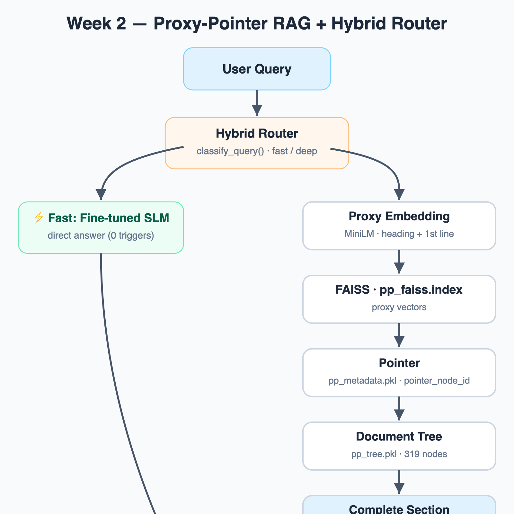

# Proxy-Pointer RAG

Structure-aware retrieval for technical documentation, benchmarked head-to-head against
fixed-size-chunk RAG — and a QLoRA fine-tune of the same corpus for comparison.

Fixed-size chunking shreds structured content. A 500-character window cuts a pipe table in
half and splits a numbered procedure across two chunks, so the model receives fragments where
it needed an intact section. This repo indexes a short **proxy** for every heading node in the
document tree, and on a hit **dereferences a pointer** back to that node's full body — so
retrieval returns a complete section, tables included, instead of a 500-character window.

## Results

30 categorized questions over two industrial equipment manuals. `all-MiniLM-L6-v2` embeddings,
FAISS `IndexFlatIP`, same generator and same question set on both sides.

| Metric | Vanilla RAG | Proxy-Pointer + router |
|---|---|---|
| Mean cosine | **0.6985** | 0.6810 |
| Retrieval correct (keyword) | **20/30 (67%)** | 14/30 (47%) |
| Mean latency | **22.2 s** | 26.7 s |

**The aggregate says vanilla wins. The per-category breakdown says that's the wrong read:**

| Category | Vanilla | Proxy-Pointer | Δ |
|---|---|---|---|
| procedure | 0.6169 | **0.6487** | **+0.032** |
| tabular | 0.6625 | 0.6608 | −0.002 |
| navigation | **0.8160** | 0.7334 | −0.083 |

The win is concentrated exactly where flat chunking fails. Q17 (a multi-step procedure)
improves **+0.42** and Q3 (an alarm table with FDA logging flags) improves **+0.30**, because
the pointer returns the section node with its table intact. The loss is concentrated on short
navigation lookups — a unique keyword in a small corpus is already trivially found by flat
chunking, and the proxy (heading + first body line) can miss a term buried mid-section.

So: proxy-pointer retrieval is the right tool for procedures and tables, and the wrong tool for
keyword lookups. A production system should route between them — which is what
`hybrid_intent_router.py` attempts.

Full numbers: [`results/week2-proxy-vs-vanilla-results.csv`](results/week2-proxy-vs-vanilla-results.csv)
· analysis: [`docs/week2-benchmark-report.md`](docs/week2-benchmark-report.md)

## How it works



1. **`parse_documents.py`** — PDFs to heading-structured markdown.
2. **`document_tree_builder.py`** — builds a `DocumentTree` of `DocumentNode`s, each carrying
   `heading_title`, `body_content`, `parent_node_id`, `start_line`/`end_line`.
3. **`proxy_pointer_indexer.py`** — embeds a proxy per content node (heading + first meaningful
   body line, under 300 chars) and stores the pointer: `pointer_node_id`, `doc_id`, line span.
   `ROOT` and `[FILE]` container nodes are excluded from the index; table-only nodes fall back
   to their heading. `verify_linkage()` round-trips random proxies back to their nodes and
   asserts each pointer still resolves to non-empty body content.
4. **`context_assembler.py`** — dereferences a hit to the node's full body.
5. **`hybrid_intent_router.py`** — classifies a query fast vs deep on a regex trigger table
   (`table`, `parameters`, `procedure`, `steps`, `how do i`, `list`, …). Zero triggers →
   fast/certain; exactly one → deep/borderline; two or more → deep/certain, biasing ambiguous
   structured questions toward the retriever.

The baseline it is measured against is `naive_rag_baseline.py`: `RecursiveCharacterTextSplitter`
at `chunk_size=500 / overlap=50`, top-k 4, stuffed into a grounded prompt.

## The fine-tuning arm

`finetune.py` QLoRA-tunes `google/gemma-3-1b-it` on instruction/output pairs synthesized from
the same corpus — 4-bit NF4, bf16 compute, LoRA `r=8` / `alpha=16` on `q_proj` and `v_proj`,
dropout 0.05, 3 epochs at `lr=2e-4`, max length 512. It is MPS-aware: it attempts local
training on Apple Silicon and, on the expected MPS kernel failure, auto-generates a Colab
notebook targeting a free T4, because the 4-bit stack is CUDA-bound.

Over 40 evaluation questions the fine-tune scored a mean cosine of 0.5079 against RAG's 0.4895
(22/40 head-to-head wins) — but see the caveat below before reading anything into that.

## Honest caveats

- **The generator is a stand-in.** `gemma-3-1b-it` is gated on Hugging Face and the evaluation
  environment had no HF auth, so every score above was generated with `TinyLlama-1.1B-Chat`.
  The retrieval and routing logic is what's being measured; absolute answer quality is not.
  Swap `_GEN_MODEL` / `_USE_ADAPTER` in `hybrid_intent_router.py` once you have auth.
- **No training curve was captured.** The LoRA adapter exists as proof training ran, but no
  loss trace or notebook output was saved. See `docs/week1-training-evidence.md`.
- **Week 1 recorded no latency.** Only Week 2 has per-question timings. Not estimated.
- **The corpus is not in this repo.** The source manuals are a third party's proprietary
  documentation, so the PDFs, the markdown conversions, the SFT dataset, the FAISS indices and
  the per-question generated answers are all excluded. The pipeline is corpus-agnostic — point
  `parse_documents.py` at your own PDFs and the rest runs.

## Running it on your own corpus

```bash
pip install sentence-transformers faiss-cpu pypdf langchain-text-splitters transformers \
            peft trl bitsandbytes

python parse_documents.py          # your PDFs -> heading-structured markdown
python proxy_pointer_indexer.py    # build proxy index + pointer metadata + tree
python run_day10_benchmark.py      # vanilla vs proxy-pointer, per category
python score.py                    # cosine scoring of answers vs references
```

`run_rag_baseline.py` runs the flat-chunk baseline alone; `finetune.py` trains the adapter.
