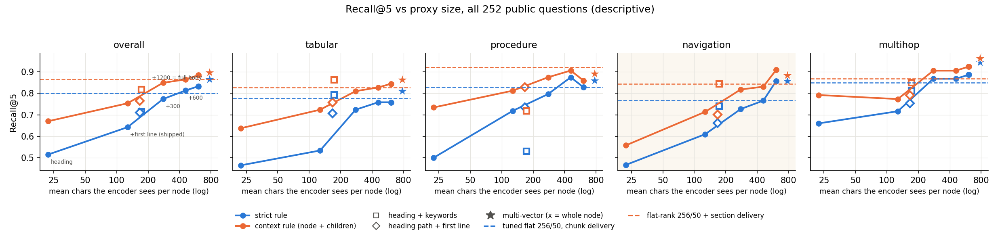
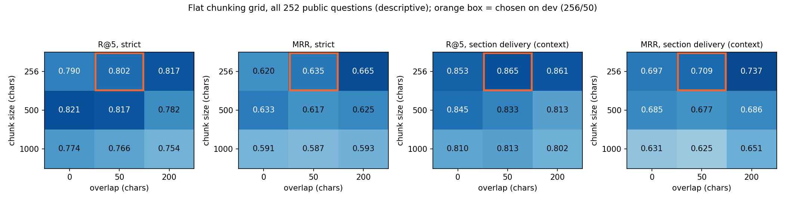

# Proxy size and chunking sweep (Task 8)

**Question.** The shipped proxy (heading + first body line, ≤ 200 chars) ranks the right
section worse than flat 500/50 chunks in every category of the public set
([evaluation-set.md](evaluation-set.md)). Is that a property of proxy-pointer retrieval, or of
a proxy that is too small? And is the flat baseline it lost to even tuned?

**Answer, in one paragraph.** It is the proxy size. Recall rises steadily as the proxy sees more
of the body, until the encoder's 256-word-piece window stops it at about 1,000 body chars. The
variant that escapes the window is **multi-vector**: the node's own text in ~500-char pieces,
with the node scored by its best piece. It was chosen on the dev half. On the held-out test half
it beats the dev-tuned flat baseline under both rules: strict MRR +0.069 [+0.015, +0.123],
context MRR +0.115 [+0.056, +0.174]. It also matches or beats every one of the nine flat
settings, including the best one on test. The navigation gap is closed and explained. The
shipped heading + first-line proxy should go. **Recommended default:** rank by section-confined
body chunks (multi-vector) and deliver the section (node + children). That keeps the repo's core
idea (whole-section delivery) and drops the short proxy. On the private corpus (30 questions,
not reproducible) multi-vector only ties flat. It doesn't contradict the recommendation, but it
doesn't independently confirm the public gain either.

Reproduce (about 1 minute on an M-series CPU, retrieval only):

```bash
./scripts/fetch_corpus.sh
HF_HUB_OFFLINE=1 python3 sweep_proxy_chunk.py --md corpus/px4_*.md \
    --questions questions/public_v1.jsonl --split questions/public_v1_split.json \
    --out-dir artifacts/public/task8 --plots-dir docs/img/task8 \
    --summary-copy results/task8_proxy_chunk_sweep_public.json
```

Outputs: `artifacts/public/task8/sweep_tables.md` (every table below and more, including the
dev and test halves per category), `sweep_per_question.csv`, and `sweep_summary.json` (copied
to [`results/task8_proxy_chunk_sweep_public.json`](../results/task8_proxy_chunk_sweep_public.json)
with the environment record).

## Method

**Corpus and questions.** PX4 User Guide v1.17.0 subset, 7 files, 654 indexable heading nodes
([corpus.md](corpus.md)). 252 questions: tabular 58, procedure 64, navigation 77, multihop 53.
Gold section labels are inline in `questions/public_v1.jsonl`.

**Proxy variants** (`proxy_variants.py`). Each variant embeds one text per node, except
multi-vector. Delivery is unchanged in every case: a hit dereferences to the node + its direct
children.

| variant | text embedded per node |
|---|---|
| `title` | heading only |
| `title_firstline` | heading + first body line not starting with `\|`/`#`, ≤ 200 chars (**shipped**) |
| `path_firstline` | ancestor headings joined with ` > ` + the same first line (disambiguates "Parameters" ×15, "See Also" ×13, …) |
| `title_keywords` | heading + table header cells and first-column cells (≤ 40) + top-20 TF-IDF body terms (node = document, smoothed idf, stopwords removed, ties alphabetical) |
| `title_body300/600/1200` | heading + first N chars of the body (whitespace collapsed, markdown otherwise raw) |
| `body_full` | heading + whole body |
| `multivector` | heading + body split by `RecursiveCharacterTextSplitter(500, 50)` **within the node**; 1,616 pieces (2.5 per node); node score = max over its pieces |

**Flat baseline.** `RecursiveCharacterTextSplitter` over the same markdown, with chunk_size
{256, 500, 1000} × overlap {0, 50, 200}. Each chunk maps to the section(s) it overlaps, by the
rule in [retrieval-metrics.md](retrieval-metrics.md). The same ranking is also scored with
**section delivery** (node + children): "rank by flat chunks, then dereference to the section".
Tables call this `hybrid:<size>/<overlap>`. It was the best cell in Task 4.

**Rules.** *Strict*: the retrieved section itself is gold. *Context*: what the system delivers
contains gold. For proxies, multi-vector and hybrid that is the node + its children. For flat
chunk delivery it is the chunk's own section(s), so context equals strict. Metrics come from
`retrieval_metrics.score_ranking`: R@1, R@5, MRR (depth 10), nDCG@5, and multihop AllParts@5.
Under the context rule nDCG@5 is not comparable across delivery types, because section delivery
also enlarges the ideal set. Use R@k and MRR there.

**No tuning on test.** `questions/public_v1_split.json` is a stratified-by-category 50/50 split
(seed 8): 125 dev and 127 test questions (tabular 29/29, procedure 32/32, navigation 38/39,
multihop 26/27). The best proxy variant (all 9 candidates) and the best flat setting (all 9)
were each chosen on **dev by strict MRR**, with ties going to the higher R@5. They were then
compared on **test** with a paired bootstrap: 10,000 resamples, seed 0, 95% percentile CI.
Full-set numbers for every config are **descriptive**: they include the questions the choice
was made on.

**Embeddings.** `all-MiniLM-L6-v2`. Each distinct text is embedded once and cached. Ranking is
a dense inner product, which is what FAISS `IndexFlatIP` computes. Sanity check: shipped proxy
and flat 500/50 reproduce Task 4 (R@5 0.643 / 0.817, flat MRR 0.617, hybrid 500/50 MRR 0.677).
The proxy MRR is 0.509 against 0.507, a float-level ranking difference on two questions.

## Finding 1: the encoder truncates, so "full body" was never full

MiniLM encodes at most 256 word-pieces including `[CLS]`/`[SEP]`, so 254 of content, about
1,000 characters of this corpus. The rest is silently dropped. Measured with the model's own
tokenizer:


| config | texts | mean chars | mean word-pieces | truncated | chars seen (sum) | mean encoded chars |
|---|---|---|---|---|---|---|
| proxy:title | 654 | 22 | 5 | 0.0% | 100.0% | 22 |
| proxy:title_firstline | 654 | 127 | 28 | 0.0% | 100.0% | 127 |
| proxy:path_firstline | 654 | 167 | 37 | 0.0% | 100.0% | 167 |
| proxy:title_keywords | 654 | 173 | 35 | 0.0% | 100.0% | 173 |
| proxy:title_body300 | 654 | 278 | 65 | 0.0% | 100.0% | 278 |
| proxy:title_body600 | 654 | 457 | 109 | 0.0% | 100.0% | 457 |
| proxy:title_body1200 | 654 | 643 | 155 | 21.3% | 94.3% | 607 |
| proxy:body_full | 654 | 772 | 187 | 23.5% | 78.7% | 608 |
| proxy:multivector | 1616 | 316 | 76 | 0.0% | 100.0% | 316 (780/node) |
| flat:256/0 | 3015 | 168 | 41 | 0.0% | 100.0% | 168 |
| flat:256/50 | 3038 | 171 | 42 | 0.0% | 100.0% | 171 |
| flat:256/200 | 3452 | 190 | 47 | 0.0% | 100.0% | 190 |
| flat:500/0 | 1407 | 363 | 88 | 0.0% | 100.0% | 363 |
| flat:500/50 | 1423 | 365 | 88 | 0.0% | 100.0% | 365 |
| flat:500/200 | 1586 | 383 | 93 | 0.0% | 100.0% | 383 |
| flat:1000/0 | 625 | 820 | 198 | 8.2% | 99.1% | 812 |
| flat:1000/50 | 631 | 820 | 198 | 10.3% | 98.9% | 811 |
| flat:1000/200 | 691 | 816 | 197 | 9.0% | 99.0% | 807 |

What this means:

- **`title_body1200` and `body_full` are the same index.** Both are cut at about 254 word-pieces
  for every node whose body is long enough to differ. They encode a mean 607 vs 608 chars, and
  their scores match to three decimals in every table. Nothing past about 1,000 chars of a
  node's body reaches the vector.
- About 1 node in 4 is truncated by `body_full`, and only 79% of the corpus text reaches the
  index. On the private corpus the bodies are longer: `body_full` sees **38%** of the text and
  40% of nodes are truncated.
- **Multi-vector escapes the window.** No piece is truncated, and a node is represented by all
  of its text (780 encoded chars per node on average, against a cap of about 600 for any single
  vector).
- Flat 1000-char chunks are themselves truncated 8 to 10% of the time on public and 36 to 41%
  on private. That is part of why the 1000 row of the flat grid is worst.

## Finding 2: recall climbs with proxy size until the window, in every category



*Recall@5 (all 252 questions, descriptive) against the mean number of characters the encoder
actually sees per node. Blue is the strict rule, orange the context rule. The solid line is the
heading → +first line → +300 → +600 → +1200/full ladder. Dashed lines are the dev-chosen flat
setting (256/50) with chunk delivery and with section delivery.*

Full set, every config (descriptive):

**all / strict / overall**

| system | n | R@1 | R@5 | MRR | nDCG@5 | multihop AllParts@5 |
|---|---|---|---|---|---|---|
| proxy:title | 252 | 0.258 | 0.516 | 0.369 | 0.355 | 0.189 |
| proxy:title_firstline | 252 | 0.401 | 0.643 | 0.509 | 0.490 | 0.321 |
| proxy:path_firstline | 252 | 0.421 | 0.710 | 0.539 | 0.525 | 0.283 |
| proxy:title_keywords | 252 | 0.425 | 0.714 | 0.554 | 0.532 | 0.358 |
| proxy:title_body300 | 252 | 0.504 | 0.774 | 0.617 | 0.596 | 0.358 |
| proxy:title_body600 | 252 | 0.528 | 0.813 | 0.642 | 0.636 | 0.415 |
| proxy:title_body1200 | 252 | 0.548 | 0.833 | 0.664 | 0.655 | 0.472 |
| proxy:body_full | 252 | 0.548 | 0.833 | 0.664 | 0.655 | 0.472 |
| proxy:multivector | 252 | 0.544 | 0.865 | 0.669 | 0.673 | 0.472 |
| flat:256/0 | 252 | 0.492 | 0.790 | 0.620 | 0.609 | 0.396 |
| flat:256/50 | 252 | 0.512 | 0.802 | 0.635 | 0.622 | 0.358 |
| flat:256/200 | 252 | 0.552 | 0.817 | 0.665 | 0.649 | 0.415 |
| flat:500/0 | 252 | 0.496 | 0.821 | 0.633 | 0.625 | 0.377 |
| flat:500/50 | 252 | 0.480 | 0.817 | 0.617 | 0.615 | 0.396 |
| flat:500/200 | 252 | 0.512 | 0.782 | 0.625 | 0.615 | 0.434 |
| flat:1000/0 | 252 | 0.456 | 0.774 | 0.591 | 0.575 | 0.358 |
| flat:1000/50 | 252 | 0.464 | 0.766 | 0.587 | 0.568 | 0.340 |
| flat:1000/200 | 252 | 0.480 | 0.754 | 0.593 | 0.572 | 0.415 |

**all / context / overall**

| system | n | R@1 | R@5 | MRR | nDCG@5 | multihop AllParts@5 |
|---|---|---|---|---|---|---|
| proxy:title | 252 | 0.429 | 0.671 | 0.535 | 0.391 | 0.415 |
| proxy:title_firstline | 252 | 0.488 | 0.754 | 0.602 | 0.447 | 0.415 |
| proxy:path_firstline | 252 | 0.484 | 0.766 | 0.602 | 0.458 | 0.340 |
| proxy:title_keywords | 252 | 0.540 | 0.817 | 0.653 | 0.483 | 0.491 |
| proxy:title_body300 | 252 | 0.599 | 0.849 | 0.701 | 0.531 | 0.472 |
| proxy:title_body600 | 252 | 0.627 | 0.865 | 0.728 | 0.556 | 0.528 |
| proxy:title_body1200 | 252 | 0.623 | 0.885 | 0.729 | 0.561 | 0.585 |
| proxy:body_full | 252 | 0.623 | 0.885 | 0.729 | 0.561 | 0.585 |
| proxy:multivector | 252 | 0.643 | 0.897 | 0.741 | 0.562 | 0.623 |
| flat:256/0 | 252 | 0.492 | 0.790 | 0.620 | 0.609 | 0.396 |
| hybrid:256/0 | 252 | 0.579 | 0.853 | 0.697 | 0.520 | 0.547 |
| flat:256/50 | 252 | 0.512 | 0.802 | 0.635 | 0.622 | 0.358 |
| hybrid:256/50 | 252 | 0.591 | 0.865 | 0.709 | 0.529 | 0.509 |
| flat:256/200 | 252 | 0.552 | 0.817 | 0.665 | 0.649 | 0.415 |
| hybrid:256/200 | 252 | 0.639 | 0.861 | 0.737 | 0.547 | 0.566 |
| flat:500/0 | 252 | 0.496 | 0.821 | 0.633 | 0.625 | 0.377 |
| hybrid:500/0 | 252 | 0.571 | 0.845 | 0.685 | 0.513 | 0.509 |
| flat:500/50 | 252 | 0.480 | 0.817 | 0.617 | 0.615 | 0.396 |
| hybrid:500/50 | 252 | 0.563 | 0.833 | 0.677 | 0.511 | 0.528 |
| flat:500/200 | 252 | 0.512 | 0.782 | 0.625 | 0.615 | 0.434 |
| hybrid:500/200 | 252 | 0.583 | 0.813 | 0.686 | 0.502 | 0.509 |
| flat:1000/0 | 252 | 0.456 | 0.774 | 0.591 | 0.575 | 0.358 |
| hybrid:1000/0 | 252 | 0.496 | 0.810 | 0.631 | 0.467 | 0.415 |
| flat:1000/50 | 252 | 0.464 | 0.766 | 0.587 | 0.568 | 0.340 |
| hybrid:1000/50 | 252 | 0.492 | 0.813 | 0.625 | 0.463 | 0.396 |
| flat:1000/200 | 252 | 0.480 | 0.754 | 0.593 | 0.572 | 0.415 |
| hybrid:1000/200 | 252 | 0.540 | 0.802 | 0.651 | 0.472 | 0.453 |

Per category, full set (descriptive), R@5 / MRR:

**all / strict / per category (R@5 / MRR)**

| system | tabular | procedure | navigation | multihop |
|---|---|---|---|---|
| proxy:title | 0.466 / 0.343 | 0.500 / 0.341 | 0.468 / 0.378 | 0.660 / 0.416 |
| proxy:title_firstline | 0.534 / 0.402 | 0.719 / 0.555 | 0.610 / 0.497 | 0.717 / 0.590 |
| proxy:path_firstline | 0.707 / 0.438 | 0.734 / 0.599 | 0.662 / 0.505 | 0.755 / 0.627 |
| proxy:title_keywords | 0.793 / 0.597 | 0.531 / 0.399 | 0.740 / 0.614 | 0.811 / 0.608 |
| proxy:title_body300 | 0.724 / 0.531 | 0.797 / 0.643 | 0.727 / 0.617 | 0.868 / 0.683 |
| proxy:title_body600 | 0.759 / 0.582 | 0.875 / 0.655 | 0.766 / 0.638 | 0.868 / 0.701 |
| proxy:title_body1200 | 0.759 / 0.624 | 0.828 / 0.618 | 0.857 / 0.688 | 0.887 / 0.727 |
| proxy:body_full | 0.759 / 0.624 | 0.828 / 0.617 | 0.857 / 0.688 | 0.887 / 0.727 |
| proxy:multivector | 0.810 / 0.610 | 0.859 / 0.675 | 0.857 / 0.688 | 0.943 / 0.701 |
| flat:256/0 | 0.759 / 0.538 | 0.797 / 0.603 | 0.766 / 0.653 | 0.849 / 0.681 |
| flat:256/50 | 0.776 / 0.543 | 0.828 / 0.635 | 0.766 / 0.660 | 0.849 / 0.699 |
| flat:256/200 | 0.793 / 0.584 | 0.859 / 0.701 | 0.766 / 0.672 | 0.868 / 0.700 |
| flat:500/0 | 0.793 / 0.606 | 0.859 / 0.681 | 0.779 / 0.613 | 0.868 / 0.633 |
| flat:500/50 | 0.759 / 0.601 | 0.844 / 0.639 | 0.779 / 0.596 | 0.906 / 0.640 |
| flat:500/200 | 0.724 / 0.582 | 0.812 / 0.636 | 0.766 / 0.621 | 0.830 / 0.667 |
| flat:1000/0 | 0.741 / 0.568 | 0.812 / 0.637 | 0.740 / 0.532 | 0.811 / 0.648 |
| flat:1000/50 | 0.724 / 0.554 | 0.812 / 0.641 | 0.753 / 0.551 | 0.774 / 0.609 |
| flat:1000/200 | 0.707 / 0.588 | 0.812 / 0.651 | 0.714 / 0.542 | 0.792 / 0.604 |

**all / context / per category (R@5 / MRR)**

| system | tabular | procedure | navigation | multihop |
|---|---|---|---|---|
| proxy:title | 0.638 / 0.502 | 0.734 / 0.572 | 0.558 / 0.459 | 0.792 / 0.639 |
| proxy:title_firstline | 0.724 / 0.539 | 0.812 / 0.660 | 0.714 / 0.552 | 0.774 / 0.675 |
| proxy:path_firstline | 0.759 / 0.530 | 0.828 / 0.676 | 0.701 / 0.530 | 0.792 / 0.697 |
| proxy:title_keywords | 0.862 / 0.666 | 0.719 / 0.559 | 0.844 / 0.695 | 0.849 / 0.693 |
| proxy:title_body300 | 0.810 / 0.638 | 0.875 / 0.738 | 0.818 / 0.664 | 0.906 / 0.778 |
| proxy:title_body600 | 0.828 / 0.669 | 0.906 / 0.756 | 0.831 / 0.701 | 0.906 / 0.796 |
| proxy:title_body1200 | 0.845 / 0.702 | 0.859 / 0.688 | 0.909 / 0.741 | 0.925 / 0.790 |
| proxy:body_full | 0.845 / 0.702 | 0.859 / 0.688 | 0.909 / 0.741 | 0.925 / 0.790 |
| proxy:multivector | 0.862 / 0.699 | 0.891 / 0.749 | 0.883 / 0.739 | 0.962 / 0.782 |
| flat:256/0 | 0.759 / 0.538 | 0.797 / 0.603 | 0.766 / 0.653 | 0.849 / 0.681 |
| hybrid:256/0 | 0.810 / 0.642 | 0.875 / 0.702 | 0.844 / 0.711 | 0.887 / 0.729 |
| flat:256/50 | 0.776 / 0.543 | 0.828 / 0.635 | 0.766 / 0.660 | 0.849 / 0.699 |
| hybrid:256/50 | 0.828 / 0.634 | 0.922 / 0.742 | 0.844 / 0.724 | 0.868 / 0.731 |
| flat:256/200 | 0.793 / 0.584 | 0.859 / 0.701 | 0.766 / 0.672 | 0.868 / 0.700 |
| hybrid:256/200 | 0.845 / 0.681 | 0.922 / 0.783 | 0.818 / 0.724 | 0.868 / 0.761 |
| flat:500/0 | 0.793 / 0.606 | 0.859 / 0.681 | 0.779 / 0.613 | 0.868 / 0.633 |
| hybrid:500/0 | 0.845 / 0.655 | 0.875 / 0.760 | 0.792 / 0.646 | 0.887 / 0.682 |
| flat:500/50 | 0.759 / 0.601 | 0.844 / 0.639 | 0.779 / 0.596 | 0.906 / 0.640 |
| hybrid:500/50 | 0.793 / 0.650 | 0.859 / 0.728 | 0.792 / 0.641 | 0.906 / 0.700 |
| flat:500/200 | 0.724 / 0.582 | 0.812 / 0.636 | 0.766 / 0.621 | 0.830 / 0.667 |
| hybrid:500/200 | 0.810 / 0.650 | 0.812 / 0.701 | 0.792 / 0.666 | 0.849 / 0.737 |
| flat:1000/0 | 0.741 / 0.568 | 0.812 / 0.637 | 0.740 / 0.532 | 0.811 / 0.648 |
| hybrid:1000/0 | 0.810 / 0.604 | 0.844 / 0.693 | 0.766 / 0.574 | 0.830 / 0.667 |
| flat:1000/50 | 0.724 / 0.554 | 0.812 / 0.641 | 0.753 / 0.551 | 0.774 / 0.609 |
| hybrid:1000/50 | 0.810 / 0.599 | 0.859 / 0.695 | 0.779 / 0.582 | 0.811 / 0.631 |
| flat:1000/200 | 0.707 / 0.588 | 0.812 / 0.651 | 0.714 / 0.542 | 0.792 / 0.604 |
| hybrid:1000/200 | 0.793 / 0.644 | 0.844 / 0.716 | 0.766 / 0.588 | 0.811 / 0.673 |

R@1 / nDCG@5 per category are in [the appendix](#appendix-r1--ndcg5-per-category-full-set).

Reading the curve:

- The ladder rises almost monotonically. Strict R@5 goes 0.516 (heading) → 0.643 (shipped) →
  0.774 (+300) → 0.813 (+600) → 0.833 (+1200 = full), and MRR goes 0.369 → 0.509 → 0.617 →
  0.642 → 0.664. **The shipped proxy sits on the steep part of the curve.** It sees about 127
  characters per node.
- **Tables:** strict R@5 goes from 0.534 for the shipped proxy to 0.759 to 0.810 for body
  proxies and multi-vector. The first-line rule skips every `|` row, so a table node's proxy is
  its heading plus maybe one intro line. `title_keywords`, which adds the table header and
  first-column cells, is the best short proxy for tables (0.793). It is also the worst for
  procedures (0.531): a bag of terms loses the sequence.
- **Heading path** helps a little over the shipped proxy (strict R@5 0.643 → 0.710). Ancestry
  is a real but small signal; body text dominates.
- **Heading only** is the worst variant on public (MRR 0.369). On the private corpus it is the
  best *single-vector* variant (see below). This is where the corpora differ.

## Finding 3: the flat baseline, tuned



*R@5 and MRR, full set (descriptive), for the nine flat settings, with chunk delivery (left two)
and section delivery (right two). The orange box marks the setting chosen on dev.*

Smaller chunks rank sections better. 256-char chunks have the best MRR, and 1000-char chunks are
worst on every metric under both deliveries. Overlap matters little except at 256/200. Dev chose
**256/50** (dev strict MRR 0.697; 256/200 was 0.687). On test, 256/50 regressed to 0.574 while
256/200 held at 0.644, so the dev choice was not the test optimum. That is why the next section
also compares the chosen proxy against every flat setting. Section delivery (`hybrid`) adds
+0.06 to +0.08 MRR on top of any flat setting, as Task 4 found.

## Finding 4: held-out test head-to-head

Choices made on dev (strict MRR):

**dev / strict / overall**

| system | n | R@1 | R@5 | MRR | nDCG@5 | multihop AllParts@5 |
|---|---|---|---|---|---|---|
| proxy:title | 125 | 0.280 | 0.520 | 0.382 | 0.363 | 0.269 |
| proxy:title_firstline | 125 | 0.408 | 0.664 | 0.525 | 0.501 | 0.385 |
| proxy:path_firstline | 125 | 0.440 | 0.728 | 0.559 | 0.541 | 0.385 |
| proxy:title_keywords | 125 | 0.472 | 0.736 | 0.588 | 0.563 | 0.423 |
| proxy:title_body300 | 125 | 0.520 | 0.800 | 0.639 | 0.610 | 0.423 |
| proxy:title_body600 | 125 | 0.552 | 0.824 | 0.658 | 0.652 | 0.500 |
| proxy:title_body1200 | 125 | 0.528 | 0.832 | 0.655 | 0.644 | 0.423 |
| proxy:body_full | 125 | 0.528 | 0.832 | 0.655 | 0.644 | 0.423 |
| proxy:multivector | 125 | 0.560 | 0.896 | 0.696 | 0.705 | 0.577 |
| flat:256/0 | 125 | 0.536 | 0.848 | 0.670 | 0.662 | 0.500 |
| flat:256/50 | 125 | 0.576 | 0.856 | 0.697 | 0.684 | 0.462 |
| flat:256/200 | 125 | 0.552 | 0.864 | 0.687 | 0.684 | 0.577 |
| flat:500/0 | 125 | 0.528 | 0.848 | 0.664 | 0.648 | 0.423 |
| flat:500/50 | 125 | 0.512 | 0.864 | 0.654 | 0.649 | 0.462 |
| flat:500/200 | 125 | 0.536 | 0.840 | 0.656 | 0.648 | 0.500 |
| flat:1000/0 | 125 | 0.520 | 0.840 | 0.658 | 0.630 | 0.346 |
| flat:1000/50 | 125 | 0.528 | 0.792 | 0.644 | 0.605 | 0.385 |
| flat:1000/200 | 125 | 0.512 | 0.792 | 0.636 | 0.606 | 0.500 |

- **Best proxy variant: `multivector`** (dev MRR 0.696). The best single-vector variant was
  `title_body600` (0.658).
- **Best flat setting: `256/50`** (dev MRR 0.697).

Test half (n = 127), chosen configs. Δ = proxy − baseline, with paired bootstrap 95% CI.
✱ = the CI excludes 0.

| comparison (test) | rule | Δ R@1 | Δ R@5 | Δ MRR | Δ nDCG@5 |
|---|---|---|---|---|---|
| multivector vs flat 256/50 (chunk delivery) | strict | +0.079 [+0.008, +0.150] ✱ | +0.087 [+0.016, +0.157] ✱ | **+0.069 [+0.015, +0.123] ✱** | +0.082 [+0.031, +0.135] ✱ |
| multivector vs flat 256/50 (chunk delivery) | context | +0.134 [+0.055, +0.213] ✱ | +0.110 [+0.039, +0.181] ✱ | **+0.115 [+0.056, +0.174] ✱** | n/c |
| multivector vs flat-rank 256/50 + section delivery | context | | +0.047 [−0.016, +0.110] | +0.051 [+0.003, +0.098] ✱ | |
| title_body600 (best single vector) vs flat 256/50 | strict | | +0.055 [−0.031, +0.142] | +0.053 [−0.015, +0.123] | |
| title_body600 (best single vector) vs flat 256/50 | context | | +0.094 [+0.008, +0.181] ✱ | +0.111 [+0.042, +0.181] ✱ | |
| shipped title_firstline vs flat 256/50 | strict | | −0.126 [−0.213, −0.039] ✱ | −0.080 [−0.158, −0.002] ✱ | |
| shipped title_firstline vs flat 256/50 | context | | −0.039 [−0.126, +0.055] | +0.007 [−0.074, +0.090] | |
| multivector vs shipped title_firstline | strict | | +0.213 [+0.142, +0.291] ✱ | +0.149 [+0.081, +0.217] ✱ | |

n/c: not comparable (see Method). Multihop AllParts@5 on test, multivector vs flat 256/50:
strict +0.111 [−0.037, +0.259], context +0.259 [+0.074, +0.444] ✱.

Per category on test (multivector vs flat 256/50):

| category (test n) | strict Δ R@5 | strict Δ MRR | context Δ R@5 | context Δ MRR |
|---|---|---|---|---|
| tabular (29) | +0.069 [−0.069, +0.207] | +0.118 [+0.041, +0.208] ✱ | +0.103 [−0.034, +0.241] | +0.222 [+0.106, +0.348] ✱ |
| procedure (32) | +0.000 [−0.156, +0.156] | +0.064 [−0.060, +0.188] | +0.000 [−0.156, +0.156] | +0.080 [−0.048, +0.206] |
| navigation (39) | +0.154 [+0.026, +0.282] ✱ | +0.072 [−0.010, +0.166] | +0.179 [+0.051, +0.333] ✱ | +0.104 [+0.013, +0.205] ✱ |
| multihop (27) | +0.111 [−0.037, +0.259] | +0.017 [−0.124, +0.148] | +0.148 [+0.037, +0.296] ✱ | +0.057 [−0.061, +0.170] |

Test half, every config:

**test / strict / overall**

| system | n | R@1 | R@5 | MRR | nDCG@5 | multihop AllParts@5 |
|---|---|---|---|---|---|---|
| proxy:title | 127 | 0.236 | 0.512 | 0.356 | 0.348 | 0.111 |
| proxy:title_firstline | 127 | 0.394 | 0.622 | 0.494 | 0.480 | 0.259 |
| proxy:path_firstline | 127 | 0.402 | 0.693 | 0.519 | 0.510 | 0.185 |
| proxy:title_keywords | 127 | 0.378 | 0.693 | 0.521 | 0.501 | 0.296 |
| proxy:title_body300 | 127 | 0.488 | 0.748 | 0.597 | 0.582 | 0.296 |
| proxy:title_body600 | 127 | 0.504 | 0.803 | 0.628 | 0.619 | 0.333 |
| proxy:title_body1200 | 127 | 0.567 | 0.835 | 0.672 | 0.666 | 0.519 |
| proxy:body_full | 127 | 0.567 | 0.835 | 0.672 | 0.666 | 0.519 |
| proxy:multivector | 127 | 0.528 | 0.835 | 0.643 | 0.643 | 0.370 |
| flat:256/0 | 127 | 0.449 | 0.732 | 0.571 | 0.557 | 0.296 |
| flat:256/50 | 127 | 0.449 | 0.748 | 0.574 | 0.561 | 0.259 |
| flat:256/200 | 127 | 0.551 | 0.772 | 0.644 | 0.614 | 0.259 |
| flat:500/0 | 127 | 0.465 | 0.795 | 0.602 | 0.601 | 0.333 |
| flat:500/50 | 127 | 0.449 | 0.772 | 0.581 | 0.582 | 0.333 |
| flat:500/200 | 127 | 0.488 | 0.724 | 0.595 | 0.582 | 0.370 |
| flat:1000/0 | 127 | 0.394 | 0.709 | 0.526 | 0.521 | 0.370 |
| flat:1000/50 | 127 | 0.402 | 0.740 | 0.531 | 0.531 | 0.296 |
| flat:1000/200 | 127 | 0.449 | 0.717 | 0.552 | 0.538 | 0.333 |

**test / context / overall**

| system | n | R@1 | R@5 | MRR | nDCG@5 | multihop AllParts@5 |
|---|---|---|---|---|---|---|
| proxy:title | 127 | 0.417 | 0.669 | 0.531 | 0.388 | 0.259 |
| proxy:title_firstline | 127 | 0.480 | 0.709 | 0.582 | 0.437 | 0.296 |
| proxy:path_firstline | 127 | 0.472 | 0.724 | 0.581 | 0.451 | 0.185 |
| proxy:title_keywords | 127 | 0.512 | 0.780 | 0.625 | 0.473 | 0.370 |
| proxy:title_body300 | 127 | 0.567 | 0.811 | 0.669 | 0.501 | 0.370 |
| proxy:title_body600 | 127 | 0.567 | 0.843 | 0.686 | 0.521 | 0.444 |
| proxy:title_body1200 | 127 | 0.614 | 0.882 | 0.719 | 0.550 | 0.593 |
| proxy:body_full | 127 | 0.614 | 0.882 | 0.719 | 0.550 | 0.593 |
| proxy:multivector | 127 | 0.583 | 0.858 | 0.689 | 0.519 | 0.519 |
| flat:256/0 | 127 | 0.449 | 0.732 | 0.571 | 0.557 | 0.296 |
| hybrid:256/0 | 127 | 0.520 | 0.787 | 0.634 | 0.468 | 0.444 |
| flat:256/50 | 127 | 0.449 | 0.748 | 0.574 | 0.561 | 0.259 |
| hybrid:256/50 | 127 | 0.512 | 0.811 | 0.639 | 0.471 | 0.370 |
| flat:256/200 | 127 | 0.551 | 0.772 | 0.644 | 0.614 | 0.259 |
| hybrid:256/200 | 127 | 0.606 | 0.811 | 0.691 | 0.500 | 0.407 |
| flat:500/0 | 127 | 0.465 | 0.795 | 0.602 | 0.601 | 0.333 |
| hybrid:500/0 | 127 | 0.504 | 0.811 | 0.634 | 0.477 | 0.481 |
| flat:500/50 | 127 | 0.449 | 0.772 | 0.581 | 0.582 | 0.333 |
| hybrid:500/50 | 127 | 0.496 | 0.787 | 0.623 | 0.470 | 0.519 |
| flat:500/200 | 127 | 0.488 | 0.724 | 0.595 | 0.582 | 0.370 |
| hybrid:500/200 | 127 | 0.528 | 0.764 | 0.638 | 0.467 | 0.444 |
| flat:1000/0 | 127 | 0.394 | 0.709 | 0.526 | 0.521 | 0.370 |
| hybrid:1000/0 | 127 | 0.425 | 0.748 | 0.562 | 0.418 | 0.370 |
| flat:1000/50 | 127 | 0.402 | 0.740 | 0.531 | 0.531 | 0.296 |
| hybrid:1000/50 | 127 | 0.433 | 0.787 | 0.572 | 0.431 | 0.333 |
| flat:1000/200 | 127 | 0.449 | 0.717 | 0.552 | 0.538 | 0.333 |
| hybrid:1000/200 | 127 | 0.504 | 0.764 | 0.611 | 0.445 | 0.370 |

**Robustness: multi-vector against every flat setting on test.** The dev-chosen 256/50 lost
ground on test, so the margin above partly reflects the flat side's winner's curse. Against all
nine settings (test, overall):


| baseline | rule | metric | delta [95% CI] |
|---|---|---|---|
| flat:256/0 | strict | MRR | +0.073 [+0.020, +0.125] ✱ |
| hybrid:256/0 | context | MRR | +0.055 [+0.010, +0.100] ✱ |
| flat:256/0 | strict | R@5 | +0.102 [+0.031, +0.173] ✱ |
| hybrid:256/0 | context | R@5 | +0.071 [+0.008, +0.134] ✱ |
| flat:256/50 | strict | MRR | +0.069 [+0.015, +0.123] ✱ |
| hybrid:256/50 | context | MRR | +0.051 [+0.003, +0.098] ✱ |
| flat:256/50 | strict | R@5 | +0.087 [+0.016, +0.157] ✱ |
| hybrid:256/50 | context | R@5 | +0.047 [-0.016, +0.110] |
| flat:256/200 | strict | MRR | -0.001 [-0.057, +0.055] |
| hybrid:256/200 | context | MRR | -0.002 [-0.053, +0.049] |
| flat:256/200 | strict | R@5 | +0.063 [+0.000, +0.126] |
| hybrid:256/200 | context | R@5 | +0.047 [-0.016, +0.110] |
| flat:500/0 | strict | MRR | +0.041 [-0.009, +0.091] |
| hybrid:500/0 | context | MRR | +0.055 [+0.005, +0.104] ✱ |
| flat:500/0 | strict | R@5 | +0.039 [-0.008, +0.094] |
| hybrid:500/0 | context | R@5 | +0.047 [+0.000, +0.102] |
| flat:500/50 | strict | MRR | +0.062 [+0.016, +0.110] ✱ |
| hybrid:500/50 | context | MRR | +0.066 [+0.020, +0.113] ✱ |
| flat:500/50 | strict | R@5 | +0.063 [+0.016, +0.118] ✱ |
| hybrid:500/50 | context | R@5 | +0.071 [+0.016, +0.126] ✱ |
| flat:500/200 | strict | MRR | +0.048 [-0.004, +0.099] |
| hybrid:500/200 | context | MRR | +0.051 [-0.000, +0.102] |
| flat:500/200 | strict | R@5 | +0.110 [+0.047, +0.173] ✱ |
| hybrid:500/200 | context | R@5 | +0.094 [+0.039, +0.157] ✱ |
| flat:1000/0 | strict | MRR | +0.117 [+0.048, +0.186] ✱ |
| hybrid:1000/0 | context | MRR | +0.127 [+0.061, +0.192] ✱ |
| flat:1000/0 | strict | R@5 | +0.126 [+0.047, +0.205] ✱ |
| hybrid:1000/0 | context | R@5 | +0.110 [+0.039, +0.181] ✱ |
| flat:1000/50 | strict | MRR | +0.112 [+0.041, +0.183] ✱ |
| hybrid:1000/50 | context | MRR | +0.118 [+0.048, +0.188] ✱ |
| flat:1000/50 | strict | R@5 | +0.094 [+0.016, +0.173] ✱ |
| hybrid:1000/50 | context | R@5 | +0.071 [+0.000, +0.142] |
| flat:1000/200 | strict | MRR | +0.092 [+0.022, +0.164] ✱ |
| hybrid:1000/200 | context | MRR | +0.078 [+0.009, +0.150] ✱ |
| flat:1000/200 | strict | R@5 | +0.118 [+0.039, +0.205] ✱ |
| hybrid:1000/200 | context | R@5 | +0.094 [+0.016, +0.173] ✱ |

Against the best flat setting *on test* (256/200), multi-vector **ties** on MRR: strict −0.001
[−0.057, +0.055], and context against its hybrid −0.002 [−0.053, +0.049]. It is ahead on R@5:
+0.063 [+0.000, +0.126] strict, +0.047 [−0.016, +0.110] context. It never does significantly
worse than any flat setting and is significantly better than most.

**Does ANY proxy variant beat the tuned flat baseline on held-out test?**

- **Strict rule: yes.** Multi-vector (the dev choice) +0.069 [+0.015, +0.123] MRR.
  `title_body1200`/`body_full` also clear zero (+0.097 [+0.029, +0.166] MRR), but they were not
  the dev choice and are listed only descriptively. No *short* proxy beats flat: `title`,
  `title_firstline`, `path_firstline`, `title_keywords` and `title_body300` are all ≤ 0 or
  inside noise.
- **Context rule: yes.** Multi-vector +0.115 [+0.056, +0.174] MRR against flat chunk delivery.
  Against the fairer opponent, flat ranking *with the same section delivery*, the margin is
  +0.051 [+0.003, +0.098] for the dev-chosen setting and a tie against the best one.

All proxy variants vs the dev-chosen flat setting (test; descriptive, because nine
comparisons are made and only multi-vector was pre-selected):


| variant | rule | metric | delta [95% CI] |
|---|---|---|---|
| proxy:title | strict | MRR | -0.218 [-0.299, -0.136] ✱ |
| proxy:title | strict | R@5 | -0.236 [-0.339, -0.134] ✱ |
| proxy:title | context | MRR | -0.043 [-0.126, +0.042] |
| proxy:title | context | R@5 | -0.079 [-0.173, +0.016] |
| proxy:title_firstline | strict | MRR | -0.080 [-0.158, -0.002] ✱ |
| proxy:title_firstline | strict | R@5 | -0.126 [-0.213, -0.039] ✱ |
| proxy:title_firstline | context | MRR | +0.007 [-0.074, +0.090] |
| proxy:title_firstline | context | R@5 | -0.039 [-0.126, +0.055] |
| proxy:path_firstline | strict | MRR | -0.055 [-0.136, +0.027] |
| proxy:path_firstline | strict | R@5 | -0.055 [-0.150, +0.039] |
| proxy:path_firstline | context | MRR | +0.007 [-0.076, +0.089] |
| proxy:path_firstline | context | R@5 | -0.024 [-0.118, +0.071] |
| proxy:title_keywords | strict | MRR | -0.054 [-0.136, +0.029] |
| proxy:title_keywords | strict | R@5 | -0.055 [-0.142, +0.031] |
| proxy:title_keywords | context | MRR | +0.051 [-0.036, +0.136] |
| proxy:title_keywords | context | R@5 | +0.031 [-0.055, +0.118] |
| proxy:title_body300 | strict | MRR | +0.022 [-0.051, +0.093] |
| proxy:title_body300 | strict | R@5 | +0.000 [-0.087, +0.087] |
| proxy:title_body300 | context | MRR | +0.094 [+0.022, +0.165] ✱ |
| proxy:title_body300 | context | R@5 | +0.063 [-0.024, +0.150] |
| proxy:title_body600 | strict | MRR | +0.053 [-0.015, +0.123] |
| proxy:title_body600 | strict | R@5 | +0.055 [-0.031, +0.142] |
| proxy:title_body600 | context | MRR | +0.111 [+0.042, +0.181] ✱ |
| proxy:title_body600 | context | R@5 | +0.094 [+0.008, +0.181] ✱ |
| proxy:title_body1200 | strict | MRR | +0.097 [+0.029, +0.166] ✱ |
| proxy:title_body1200 | strict | R@5 | +0.087 [+0.000, +0.173] |
| proxy:title_body1200 | context | MRR | +0.144 [+0.076, +0.214] ✱ |
| proxy:title_body1200 | context | R@5 | +0.134 [+0.047, +0.220] ✱ |
| proxy:body_full | strict | MRR | +0.097 [+0.029, +0.166] ✱ |
| proxy:body_full | strict | R@5 | +0.087 [+0.000, +0.173] |
| proxy:body_full | context | MRR | +0.144 [+0.076, +0.214] ✱ |
| proxy:body_full | context | R@5 | +0.134 [+0.047, +0.220] ✱ |
| proxy:multivector | strict | MRR | +0.069 [+0.015, +0.123] ✱ |
| proxy:multivector | strict | R@5 | +0.087 [+0.016, +0.157] ✱ |
| proxy:multivector | context | MRR | +0.115 [+0.056, +0.174] ✱ |
| proxy:multivector | context | R@5 | +0.110 [+0.039, +0.181] ✱ |

## Navigation: verdict

**Closed and explained.**

- *Closed.* Navigation strict R@5 on the full set: shipped proxy 0.610, flat 500/50 0.779,
  flat 256/50 0.766, multi-vector 0.857, `title_body1200` 0.857. On test, multi-vector beats
  the tuned flat baseline on navigation, strict R@5 +0.154 [+0.026, +0.282] ✱, and beats the
  shipped proxy by +0.205 [+0.077, +0.359] ✱.
- *Explained by proxy size, not by the pointer idea.* In the recall-vs-size plot the navigation
  curve is the steepest: strict R@5 nearly doubles from the heading alone (0.468) to
  +1200 (0.857), and it only clears the flat line at the +1200 point, about 600 encoded
  chars of body. A direct check on the hypothesis uses each question's `keywords`. A keyword
  appears in the *encoded* part of a gold node's shipped proxy for only **23%** of navigation
  questions, against 83% for +600 and 94% for +1200. With the +600 proxy, navigation R@5 is
  0.812 when a keyword is visible and 0.538 when it isn't.
- *Caveat.* Inside the shipped proxy, keyword visibility does not predict success (R@5 0.611
  visible vs 0.610 hidden; only 18 of 77 visible). "One distinctive term buried mid-section" is
  too narrow a story. What the shipped proxy lacks is body text in general; the specific
  keyword is a marker for that.


| proxy | overall | tabular | procedure | navigation | multihop |
|---|---|---|---|---|---|
| proxy:title | 10% vis; 0.583 / 0.509 | 3% vis; 0.500 / 0.464 | 17% vis; 0.636 / 0.472 | 4% vis; 0.333 / 0.473 | 15% vis; 0.625 / 0.667 |
| proxy:title_firstline | 25% vis; 0.703 / 0.622 | 5% vis; 0.667 / 0.527 | 39% vis; 0.720 / 0.718 | 23% vis; 0.611 / 0.610 | 34% vis; 0.778 / 0.686 |
| proxy:path_firstline | 27% vis; 0.687 / 0.719 | 5% vis; 0.333 / 0.727 | 44% vis; 0.643 / 0.806 | 23% vis; 0.722 / 0.644 | 34% vis; 0.778 / 0.743 |
| proxy:title_keywords | 82% vis; 0.718 / 0.696 | 86% vis; 0.780 / 0.875 | 84% vis; 0.556 / 0.400 | 71% vis; 0.745 / 0.727 | 89% vis; 0.809 / 0.833 |
| proxy:title_body300 | 58% vis; 0.814 / 0.720 | 26% vis; 0.600 / 0.767 | 77% vis; 0.816 / 0.733 | 51% vis; 0.846 / 0.605 | 79% vis; 0.857 / 0.909 |
| proxy:title_body600 | 81% vis; 0.839 / 0.702 | 53% vis; 0.774 / 0.741 | 94% vis; 0.883 / 0.750 | 83% vis; 0.812 / 0.538 | 94% vis; 0.860 / 1.000 |
| proxy:title_body1200 | 90% vis; 0.846 / 0.720 | 69% vis; 0.750 / 0.778 | 98% vis; 0.841 / 0.000 | 94% vis; 0.875 / 0.600 | 98% vis; 0.885 / 1.000 |
| proxy:body_full | 90% vis; 0.846 / 0.720 | 69% vis; 0.750 / 0.778 | 98% vis; 0.841 / 0.000 | 94% vis; 0.875 / 0.600 | 98% vis; 0.885 / 1.000 |

*Each cell: share of questions where a question keyword appears in the encoded proxy text of a
gold node; strict R@5 when visible / when hidden. All 252 questions. Multi-vector is not a single
text and is omitted.*

## Why this proxy size?

There is no proxy size worth tuning in the single-vector design. The curve rises until the
encoder stops reading (about 254 word-pieces, roughly 1,000 body chars here), and past that
"+1200" and "full body" are literally the same vector. The defensible choices are:

1. **Multi-vector with ~500-char pieces (recommended).** It keeps the whole node visible to the
   encoder, and each piece is well inside the window (0% truncated). 500 also sits in the
   256 to 500 range where the flat grid peaks; 1000-char chunks are worst. Piece size was fixed
   in advance and *not* swept for multi-vector (to avoid tuning on test after seeing it), so
   256 vs 500 pieces is open.
2. If one vector per node is a hard constraint: **heading + first 600 to 1,200 body chars**.
   Below 600 recall is still climbing. Above about 1,000 chars nothing changes, because the
   encoder truncates. On test `title_body600` was +0.053 [−0.015, +0.123] strict MRR vs tuned
   flat, a tie.
3. Not the shipped 200-char first line. On test it is −0.080 [−0.158, −0.002] ✱ strict MRR
   against tuned flat, and −0.149 against multi-vector.

**Why multi-vector beats flat chunks at all.** It is flat chunking with one change: chunks never
cross a heading boundary, and every piece maps to exactly one section. A flat chunk that
straddles a boundary emits several sections at consecutive ranks, ordered by overlap. That
pushes the gold section down and can lead with the tail of the previous section. Confining
chunks to the heading tree removes that. The repo's structural idea pays off in *how chunks are
cut and where they point*, not in a short proxy.

## Private corpus (secondary check; not reproducible, aggregates only)

Same script and configs: 30 questions (10 tabular, 10 procedure, 10 navigation), 316 nodes, gold
from the Task 2 labels. There is no dev/test split at n = 30. "Best" here is picked on the same
30 questions, so it is descriptive only.

| config | strict R@1 | strict R@5 | strict MRR | context R@5 | context MRR |
|---|---|---|---|---|---|
| proxy:title | 0.667 | 0.733 | 0.700 | 0.800 | 0.761 |
| proxy:title_firstline | 0.500 | 0.700 | 0.569 | 0.800 | 0.618 |
| proxy:path_firstline | 0.433 | 0.700 | 0.532 | 0.733 | 0.555 |
| proxy:title_keywords | 0.433 | 0.800 | 0.590 | 0.867 | 0.657 |
| proxy:title_body300 | 0.500 | 0.767 | 0.597 | 0.867 | 0.646 |
| proxy:title_body600 | 0.400 | 0.767 | 0.553 | 0.800 | 0.599 |
| proxy:title_body1200 | 0.400 | 0.733 | 0.550 | 0.767 | 0.596 |
| proxy:body_full | 0.400 | 0.733 | 0.550 | 0.767 | 0.596 |
| proxy:multivector | 0.600 | 0.900 | 0.708 | 0.933 | 0.714 |
| flat:256/0 | 0.533 | 0.933 | 0.711 | 0.933 | 0.711 |
| hybrid:256/0 (section delivery) | | | | 0.933 | 0.729 |
| flat:256/50 | 0.533 | 0.933 | 0.722 | 0.933 | 0.722 |
| hybrid:256/50 (section delivery) | | | | 0.933 | 0.772 |
| flat:256/200 | 0.567 | 0.900 | 0.705 | 0.900 | 0.705 |
| hybrid:256/200 (section delivery) | | | | 0.900 | 0.706 |
| flat:500/0 | 0.467 | 0.867 | 0.631 | 0.867 | 0.631 |
| hybrid:500/0 (section delivery) | | | | 0.867 | 0.632 |
| flat:500/50 | 0.600 | 0.867 | 0.716 | 0.867 | 0.716 |
| hybrid:500/50 (section delivery) | | | | 0.900 | 0.717 |
| flat:500/200 | 0.567 | 0.933 | 0.739 | 0.933 | 0.739 |
| hybrid:500/200 (section delivery) | | | | 0.933 | 0.739 |
| flat:1000/0 | 0.433 | 0.867 | 0.600 | 0.867 | 0.600 |
| hybrid:1000/0 (section delivery) | | | | 0.867 | 0.633 |
| flat:1000/50 | 0.467 | 0.867 | 0.609 | 0.867 | 0.609 |
| hybrid:1000/50 (section delivery) | | | | 0.867 | 0.626 |
| flat:1000/200 | 0.567 | 0.800 | 0.691 | 0.800 | 0.691 |
| hybrid:1000/200 (section delivery) | | | | 0.800 | 0.691 |

- The shipped proxy is again worse than flat (strict MRR 0.569 vs 0.716 for flat 500/50).
- The size curve does **not** reproduce. Heading-only is the best single vector (MRR 0.700) and
  body proxies *fall* (+1200 0.550). Private headings are distinctive, and bodies are long and
  truncated: `body_full` encodes only 38% of the text, and the first 1,000 chars of a long
  section dilute a distinctive heading. Single-vector proxy size is corpus-dependent. That is one
  more reason not to rely on it.
- **Multi-vector ties flat** (strict MRR 0.708 vs 0.716 to 0.739 for the 500/50, 256/50 and
  500/200 flat settings; with ±0.13 CIs at n = 30, no difference is detectable). It has the best
  context R@5 of any proxy (0.933). Flat-rank + section delivery (256/50) has the best private
  context MRR (0.772), which also points to "rank by body chunks, deliver the section". So the
  private corpus is consistent with the recommendation:
  it does not show a multi-vector gain, but it shows no loss.

## Recommendation

1. **Default retrieval: multi-vector over the heading tree, with section delivery.** Embed each
   node's own text in ~500-char pieces (`RecursiveCharacterTextSplitter(500, 50)` inside the
   node), score a node by its best piece, and return the node + its direct children. In plain
   terms: **rank by (section-confined) body chunks, deliver the section.** This keeps
   whole-section delivery, which the context-rule results support, and drops the short proxy.
2. **Retire `title_firstline`** as the default proxy. It loses to tuned flat under the strict
   rule on held-out test, and to multi-vector by about 0.15 MRR.
3. If the index must stay one vector per node, use heading + the first ~600 to 1,000 body chars,
   and know that anything longer is truncated by MiniLM.
4. **What to compare against from now on:** flat-rank + section delivery (`hybrid`) is the
   honest baseline for section delivery. Multi-vector ties its best setting and beats the
   dev-chosen one. Plain flat chunk delivery is a weaker baseline.

## Limitations

- Labels are LLM-drafted and LLM-verified; the human spot-check is pending
  ([evaluation-set.md](evaluation-set.md)). Writers saw the gold section, which favours methods
  that embed body text: both flat and the larger proxies.
- One encoder (MiniLM, 256 word-pieces). With a longer-context encoder the single-vector curve
  could keep rising past 1,000 chars, and the gap between body proxies and multi-vector could
  shrink.
- The test half is 127 questions. Per-category CIs are wide, and the any-variant table makes
  nine comparisons without correction.
- Multi-vector piece size (500/50) was not swept.
- Retrieval only. Whether section delivery helps *answers* depends on the generator's context
  cap (Tasks 5 and 6), because a section can be much longer than a chunk.

## Environment

`sentence-transformers/all-MiniLM-L6-v2` (max_seq_length 256) on cpu, seed 0, bootstrap 10,000;
Python 3.9.6, sentence-transformers 5.1.2, transformers 4.57.6, torch 2.8.0, faiss-cpu 1.13.0,
numpy 2.0.2, langchain-text-splitters 0.3.11; macOS arm64. Run 2026-11-26 at commit `b0c44a2`
(clean tree). Corpus PX4 User Guide v1.17.0 @ `d6f12ad`; combined sha256 of the 7 converted files
`e7c5e0a26ff51666…` (per-file hashes in the summary JSON).

## Appendix: R@1 / nDCG@5 per category, full set

**all / strict / per category (R@1 / nDCG@5)**

| system | tabular | procedure | navigation | multihop |
|---|---|---|---|---|
| proxy:title | 0.259 / 0.361 | 0.234 / 0.357 | 0.286 / 0.363 | 0.245 / 0.337 |
| proxy:title_firstline | 0.293 / 0.415 | 0.453 / 0.560 | 0.390 / 0.493 | 0.472 / 0.484 |
| proxy:path_firstline | 0.259 / 0.482 | 0.500 / 0.595 | 0.390 / 0.512 | 0.547 / 0.507 |
| proxy:title_keywords | 0.448 / 0.613 | 0.266 / 0.391 | 0.506 / 0.600 | 0.472 / 0.513 |
| proxy:title_body300 | 0.397 / 0.565 | 0.516 / 0.638 | 0.545 / 0.610 | 0.547 / 0.559 |
| proxy:title_body600 | 0.466 / 0.604 | 0.516 / 0.688 | 0.558 / 0.647 | 0.566 / 0.590 |
| proxy:title_body1200 | 0.517 / 0.637 | 0.453 / 0.639 | 0.610 / 0.711 | 0.604 / 0.614 |
| proxy:body_full | 0.517 / 0.637 | 0.453 / 0.639 | 0.610 / 0.711 | 0.604 / 0.614 |
| proxy:multivector | 0.483 / 0.642 | 0.531 / 0.707 | 0.584 / 0.712 | 0.566 / 0.611 |
| flat:256/0 | 0.397 / 0.579 | 0.469 / 0.622 | 0.545 / 0.656 | 0.547 / 0.557 |
| flat:256/50 | 0.397 / 0.589 | 0.516 / 0.654 | 0.545 / 0.663 | 0.585 / 0.561 |
| flat:256/200 | 0.448 / 0.618 | 0.594 / 0.715 | 0.571 / 0.669 | 0.585 / 0.573 |
| flat:500/0 | 0.483 / 0.631 | 0.562 / 0.707 | 0.468 / 0.619 | 0.472 / 0.526 |
| flat:500/50 | 0.483 / 0.622 | 0.500 / 0.673 | 0.455 / 0.614 | 0.491 / 0.539 |
| flat:500/200 | 0.483 / 0.594 | 0.516 / 0.653 | 0.506 / 0.642 | 0.547 / 0.553 |
| flat:1000/0 | 0.431 / 0.584 | 0.500 / 0.644 | 0.390 / 0.543 | 0.528 / 0.529 |
| flat:1000/50 | 0.431 / 0.565 | 0.516 / 0.641 | 0.429 / 0.561 | 0.491 / 0.490 |
| flat:1000/200 | 0.500 / 0.586 | 0.547 / 0.659 | 0.416 / 0.529 | 0.472 / 0.514 |

**all / context / per category (R@1 / nDCG@5)**

| system | tabular | procedure | navigation | multihop |
|---|---|---|---|---|
| proxy:title | 0.397 / 0.392 | 0.469 / 0.449 | 0.364 / 0.336 | 0.509 / 0.399 |
| proxy:title_firstline | 0.414 / 0.417 | 0.547 / 0.526 | 0.429 / 0.403 | 0.585 / 0.449 |
| proxy:path_firstline | 0.362 / 0.465 | 0.578 / 0.523 | 0.403 / 0.404 | 0.623 / 0.453 |
| proxy:title_keywords | 0.534 / 0.536 | 0.438 / 0.428 | 0.597 / 0.487 | 0.585 / 0.484 |
| proxy:title_body300 | 0.517 / 0.531 | 0.641 / 0.581 | 0.571 / 0.499 | 0.679 / 0.520 |
| proxy:title_body600 | 0.552 / 0.538 | 0.656 / 0.622 | 0.610 / 0.533 | 0.698 / 0.530 |
| proxy:title_body1200 | 0.603 / 0.552 | 0.547 / 0.581 | 0.649 / 0.568 | 0.698 / 0.538 |
| proxy:body_full | 0.603 / 0.552 | 0.547 / 0.581 | 0.649 / 0.568 | 0.698 / 0.538 |
| proxy:multivector | 0.586 / 0.539 | 0.641 / 0.609 | 0.649 / 0.556 | 0.698 / 0.539 |
| flat:256/0 | 0.397 / 0.579 | 0.469 / 0.622 | 0.545 / 0.656 | 0.547 / 0.557 |
| hybrid:256/0 | 0.517 / 0.494 | 0.578 / 0.544 | 0.610 / 0.538 | 0.604 / 0.494 |
| flat:256/50 | 0.397 / 0.589 | 0.516 / 0.654 | 0.545 / 0.663 | 0.585 / 0.561 |
| hybrid:256/50 | 0.500 / 0.500 | 0.625 / 0.563 | 0.610 / 0.547 | 0.623 / 0.492 |
| flat:256/200 | 0.448 / 0.618 | 0.594 / 0.715 | 0.571 / 0.669 | 0.585 / 0.573 |
| hybrid:256/200 | 0.569 / 0.517 | 0.688 / 0.604 | 0.636 / 0.541 | 0.660 / 0.519 |
| flat:500/0 | 0.483 / 0.631 | 0.562 / 0.707 | 0.468 / 0.619 | 0.472 / 0.526 |
| hybrid:500/0 | 0.534 / 0.492 | 0.688 / 0.587 | 0.519 / 0.494 | 0.547 / 0.473 |
| flat:500/50 | 0.483 / 0.622 | 0.500 / 0.673 | 0.455 / 0.614 | 0.491 / 0.539 |
| hybrid:500/50 | 0.534 / 0.494 | 0.641 / 0.579 | 0.519 / 0.489 | 0.566 / 0.481 |
| flat:500/200 | 0.483 / 0.594 | 0.516 / 0.653 | 0.506 / 0.642 | 0.547 / 0.553 |
| hybrid:500/200 | 0.534 / 0.481 | 0.609 / 0.543 | 0.558 / 0.505 | 0.642 / 0.471 |
| flat:1000/0 | 0.431 / 0.584 | 0.500 / 0.644 | 0.390 / 0.543 | 0.528 / 0.529 |
| hybrid:1000/0 | 0.448 / 0.479 | 0.562 / 0.539 | 0.442 / 0.422 | 0.547 / 0.433 |
| flat:1000/50 | 0.431 / 0.565 | 0.516 / 0.641 | 0.429 / 0.561 | 0.491 / 0.490 |
| hybrid:1000/50 | 0.448 / 0.487 | 0.578 / 0.534 | 0.455 / 0.428 | 0.491 / 0.403 |
| flat:1000/200 | 0.500 / 0.586 | 0.547 / 0.659 | 0.416 / 0.529 | 0.472 / 0.514 |
| hybrid:1000/200 | 0.517 / 0.471 | 0.625 / 0.548 | 0.468 / 0.420 | 0.566 / 0.456 |
